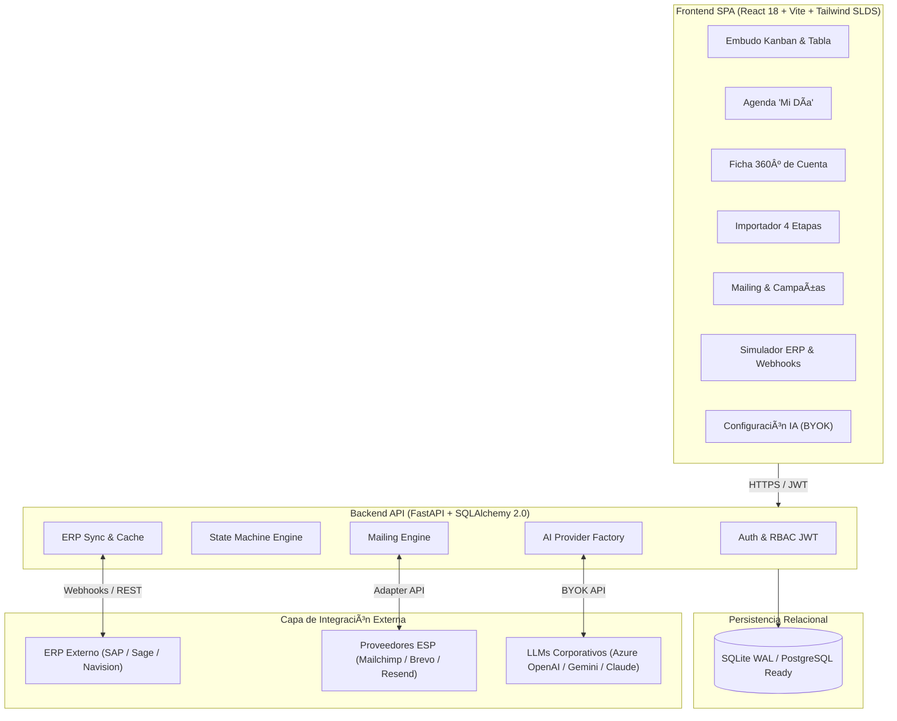

# âš¡ Nexus CRM · Enterprise B2B Engine

<div align="center">


<p align="center">
  <strong>Plataforma comercial B2B con máquina de estados estricta, jerarquía mayorista (Distribuidor vs. Cliente Final), integración ERP, motor de importación masiva en 4 etapas y arquitectura de Inteligencia Artificial BYOK (Bring Your Own Key).</strong>
</p>

<p align="center">
  <a href="https://joangranell.github.io/Nexus-CRM/" target="_blank">
    
  </a>
</p>

<p align="center">
  👉 <strong><a href="https://joangranell.github.io/Nexus-CRM/">https://joangranell.github.io/Nexus-CRM/</a></strong> 👈
</p>

[🌐 Demo Interactiva en Vivo](https://joangranell.github.io/Nexus-CRM/) •
[✨ Funcionalidades](#-funcionalidades-clave) •
[📐 Reglas de Oro](#-reglas-de-oro-del-negocio) •
[🏗️ Arquitectura](#%EF%B8%8F-arquitectura-del-sistema) •
[🚀 Inicio Rápido](#-inicio-rápido-en-windows) •
[🧪 Tests Automatizados](#-batería-de-tests-automatizados-2525)

</div>

---

## 🎯 Por qué Nexus CRM: El Problema de los CRM Tradicionales

El 70% de las implantaciones de CRM tradicionales (Salesforce, HubSpot, Zoho) fracasan en entornos B2B industriales y de distribución mayorista: exigen burocracia interminable que el comercial rechaza y arrojan *forecasts* hinchados en los que dirección no confía.

| Enfoque Tradicional | Enfoque Nexus CRM |
| :--- | :--- |
| **Oportunidades ficticias** creadas para justificar actividad semanal. | **Salvaguarda de forecasting:** Si no hay importe (€) y fecha de cierre, no entra en previsión ni pasa a Potencial. |
| **Comerciales marcan "Ganado"** sin pedido real emitido. | **Conversión exclusiva por ERP:** Una cuenta solo pasa a `CLIENTE` cuando el ERP sincroniza su primer pedido firme. |
| **Confusión de canal:** No distingue quién consume de quién abona. | **Jerarquía nativa de 2 niveles:** `Distribuidor` (*Cliente Factura*) frente a `Cliente Final` (*Cliente Pedido*). |
| **Marketing infla leads:** Un clic en newsletter promueve a venta. | **Puente Marketing ➔ Ventas:** Clics de alta intención generan tareas prioritarias; el lead solo avanza ante contacto humano efectivo. |
| **IA cautiva y costosa:** Tarifas abusivas por usuario y datos expuestos. | **IA BYOK (*Bring Your Own Key*):** Conecta Azure OpenAI, OpenAI, Gemini o Claude a coste de API, o usa el modo Mock sin coste. |

---

## ✨ Funcionalidades Clave

### 1. 🔄 Máquina de Estados Estricta & Embudo Secuencial
* Ciclo de vida determinista: **`LEAD` ➔ `PROSPECTO` ➔ `POTENCIAL` ➔ `CLIENTE`** (más estado `INACTIVO`).
* Separación formal entre **Cuenta Jurídica** (relación a largo plazo) y **Oportunidades** (negociaciones valoradas 1:N).
* Promoción automática a `PROSPECTO` ante contacto humano directo (`CALL_EFFECTIVE`, `EMAIL_1TO1`, `MEETING_VISIT`, `INBOUND_REPLY`).
* Promoción a `POTENCIAL` condicionada a la cuantificación económica del proyecto.
* Reciclaje automático de cuentas estancadas (>60 días sin actividad).

### 2. 📅 Agenda Comercial "Mi Día" & Ficha 360º
* Panel diario para comerciales con foco en ejecución: tareas vencidas, tareas de hoy con badge de prioridad (`NORMAL`, `HIGH_INTENT`, `CHURN_ALERT`) y citas futuras.
* Modal de registro de actividad en 1-clic con programación obligatoria de la próxima acción.
* **Cajón Lateral 360º (*AccountDrawer*):** Vista integral sin recarga con datos fiscales, métricas financieras YTD/LTV del ERP, timeline de notas y oportunidades.

### 3. 🏢 Jerarquía Mayorista (Distribuidor vs. Cliente Final)
* Modela la realidad del canal indirecto B2B:
  * **Distribuidor Oficial:** Asume el riesgo financiero y la facturación consolidada.
  * **Cliente Final (Canal Indirecto):** Punto de venta, restaurante, taller o filial donde se realiza la prescripción técnica y el consumo (*Cliente Pedido*).
* Vinculación obligatoria de todo Cliente Final a su distribuidor activo con doble trazabilidad en pedidos.

### 4. 📥 Motor de Importación Masiva en 4 Etapas
* **Etapa 1 (Carga & Staging):** Ingesta segura de `.csv`, `.xlsx` o `.json` en tabla aislada sin alterar la base de datos principal.
* **Etapa 2 (Mapeo Inteligente):** Mapeador dinámico de campos, tipología y relaciones de distribución.
* **Etapa 3 (Deduplicación Difusa & Salvaguarda):** Algoritmo de *fuzzy matching* por CIF, razón social, email y teléfono. Degrada automáticamente registros a `PROSPECTO` si carecen de importe/fecha.
* **Etapa 4 (Consolidación Jerárquica):** Procesa primero los distribuidores y luego los Clientes Finales vinculados.

### 5. 📧 Mailing Multi-ESP & Puente Marketing ➔ Ventas
* **Patrón Adapter:** Conectores desacoplados para **Mailchimp**, **Brevo**, **Resend** y **Sandbox Local** de pruebas.
* **Segmentador Dinámico:** Estimación de audiencia en tiempo real filtrando por etapa, actividad o consumo en ERP.
* **Higiene RGPD Automática:** Desactivación inmediata ante *Hard Bounces* y bajas voluntarias (*Unsubscribe / Spam*).
* **Puente de Alta Intención (🔥):** Los clics en enlaces cualificados (*ej. Solicitar Tarifa*) disparan tareas de máxima prioridad al comercial sin alterar el estado del lead.

### 6. 🤖 Arquitectura IA BYOK Multi-Proveedor (5 Módulos B2B)
* Módulo deshabilitado por defecto para garantizar soberanía de datos y privacidad.
* Compatible con **Microsoft Azure OpenAI / Copilot**, **OpenAI (GPT-4o)**, **Google Gemini (2.5 Flash)**, **Anthropic Claude (3.5 Sonnet)** y **Mock Local**.
* **Los 5 Módulos de IA:**
  * **AI Lead Enricher:** Infiere sector, tamaño y propuesta comercial a partir de la web corporativa.
  * **Voice-to-CRM:** Dictado por voz de post-visita; extrae acuerdos, importe (€), fecha de cierre y genera oportunidades.
  * **Inbox Sync:** Análisis semántico de correos para detectar intención y cualificación.
  * **Motor Predictivo de Churn ERP:** Analiza intervalos de recompra y genera alertas predictivas antes de la pérdida del cliente.
  * **Redactor de Mailing IA:** Asistente generador de copys personalizados con variables dinámicas (`{{nombre}}`, `{{empresa}}`).

---

## 🏗️ Arquitectura del Sistema



---

## 🚀 Inicio Rápido en Windows

### Opción 1: Lanzador automatizado (PowerShell)
```powershell
powershell -ExecutionPolicy Bypass -File .\start_windows.ps1
```
*El script verifica Python y Node.js, crea el `.venv`, instala dependencias, ejecuta el seed de la base de datos y arranca backend y frontend automáticamente.*

### Opción 2: Arranque manual paso a paso

1. **Configurar el Backend:**
   ```powershell
   python -m venv .venv
   .\.venv\Scripts\pip install -r backend\requirements.txt
   .\.venv\Scripts\python backend\seed.py
   .\.venv\Scripts\python -m uvicorn app.main:app --app-dir backend --host 127.0.0.1 --port 8000 --reload
   ```
   * Swagger interactivo: [http://127.0.0.1:8000/docs](http://127.0.0.1:8000/docs)

2. **Configurar el Frontend:**
   ```powershell
   cd frontend
   npm install
   npm run dev
   ```
   * Aplicación Web: [http://localhost:5173](http://localhost:5173)

---

## 🔑 Perfiles y Credenciales de Demostración

La pantalla de login incluye botones de **acceso rápido en 1-clic** para cada rol:

| Rol | Nombre | Email | Contraseña | Capacidades |
| :--- | :--- | :--- | :--- | :--- |
| **`SUPER_ADMIN`** | Super Admin | `superadmin@nexuscrm.com` | `superadmin123` | Control total, alta de usuarios, credenciales de IA corporativa y configuración ERP. |
| **`ADMIN_MARKETING`** | Elena Directora | `admin@nexuscrm.com` | `admin123` | Supervisión comercial global, importador masivo, campañas de mailing y simulador ERP. |
| **`COMERCIAL`** | Carlos Gómez | `carlos@nexuscrm.com` | `comercial123` | Gestión de cartera propia, bolsa de leads, agenda "Mi Día" y registro de actividad. |
| **`COMERCIAL`** | Laura Martín | `laura@nexuscrm.com` | `comercial123` | Fuerza de ventas especializada con cartera asignada. |

---

## 🧪 Batería de Tests Automatizados (25/25)

El sistema cuenta con una exhaustiva suite de pruebas unitarias y de integración:

```powershell
.\.venv\Scripts\python.exe -m pytest -v
```

```text
backend/tests/test_phase1.py::test_auth_login PASSED
backend/tests/test_phase1.py::test_lead_call_no_answer_increments_attempts PASSED
backend/tests/test_phase1.py::test_lead_effective_contact_promotes_to_prospecto_and_then_potencial PASSED
backend/tests/test_phase1.py::test_public_webhook_lead PASSED
backend/tests/test_phase1.py::test_task_update_and_delete PASSED
backend/tests/test_phase2.py::test_import_csv_lifecycle_and_deduplication PASSED
backend/tests/test_phase2.py::test_erp_sandbox_order_promotes_potencial_to_cliente PASSED
backend/tests/test_phase2.py::test_erp_webhook_endpoint PASSED
backend/tests/test_phase2.py::test_push_potencial_to_erp PASSED
backend/tests/test_phase3.py::test_mailing_templates_crud PASSED
backend/tests/test_phase3.py::test_segment_estimation_and_hygiene_exclusion PASSED
backend/tests/test_phase3.py::test_campaign_dispatch_and_variable_rendering PASSED
backend/tests/test_phase3.py::test_golden_rule_high_intent_click_creates_urgent_task_without_promoting_lead PASSED
backend/tests/test_phase3.py::test_automatic_database_hygiene_hard_bounce_and_unsubscribe PASSED
backend/tests/test_phase4.py::test_ai_config_disabled_by_default_and_crud PASSED
backend/tests/test_phase4.py::test_ai_test_connection PASSED
backend/tests/test_phase4.py::test_ai_disabled_guard PASSED
backend/tests/test_phase4.py::test_case_a_ai_lead_enricher PASSED
backend/tests/test_phase4.py::test_case_b_voice_to_crm_opportunity_and_promotion PASSED
backend/tests/test_phase4.py::test_case_c_email_intent_detection PASSED
backend/tests/test_phase4.py::test_case_d_churn_risk_detection_and_task PASSED
backend/tests/test_phase4.py::test_case_e_generate_campaign_copy PASSED
backend/tests/test_prospect_hierarchy.py::test_qualify_account_distributor_and_final_client_hierarchy PASSED
backend/tests/test_prospect_hierarchy.py::test_erp_order_traceability_final_client_and_distributor PASSED
backend/tests/test_prospect_hierarchy.py::test_importer_forecasting_safeguard_and_hierarchy PASSED

====================== 25 passed in 2.54s =======================
```

---

## 📄 Licencia

Proyecto empresarial desarrollado para entornos comerciales B2B y distribución mayorista. Todos los derechos reservados © 2026 Nexus CRM.

